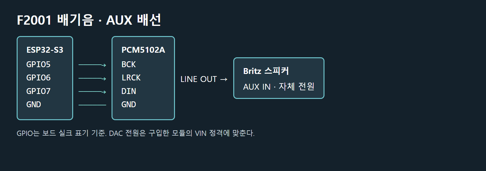

# F2001 배기음 · ESP32-S3에서 Britz AUX까지

F2001 가상 엔진음은 ESP32-S3의 I²S 출력을 PCM5102A에서 아날로그 스테레오로 변환해 Britz 스피커의 AUX IN에 보낸다. 3.5 mm 라인 입력과 자체 전원이 있는 스피커를 기준으로 한다.

## 배선

| ESP32-S3 보드 표기 | PCM5102A 모듈 표기 | 역할 |
|---|---|---|
| GPIO5 | BCK / BCLK | 비트 클록 |
| GPIO6 | LCK / LRCK / WS | 좌우 채널 클록 |
| GPIO7 | DIN | ESP에서 DAC로 보내는 오디오 데이터 |
| GND | GND | 공통 접지 |

DAC 전원은 해당 모듈의 VIN 정격을 확인해 공급한다. 모듈은 3선 Philips I²S 모드로 설정한다. 외부 MCLK를 출력하지 않으므로 SCK·FMT·XSMT의 점퍼 처리는 구입한 모듈 설명을 따른다. 3.5 mm LINE OUT에는 스피커의 입력 플러그를 꽂는다. 양쪽 모두 암단자라면 스테레오 수–수 케이블을 사용한다. 스피커에는 원래 전원을 공급한다. MAX98357A의 SPK±는 패시브 스피커용 차동 출력이므로 AUX에 연결하면 안 된다.

## 확인 결과

- 게이트웨이 소스에서 GPIO5/6/7을 BCLK/WS/DOUT에 할당했다. 현재 설정에서 PIT 입력은 GPIO4, BMS CAN은 GPIO9/8, 후방 UART는 GPIO18/17, 상태 LED 구동은 GPIO38을 사용한다.
- 로컬 `esp32-s3-r8` 빌드 성공. 출력은 32 kHz, 16비트 Philips I²S이며 양 채널에 같은 엔진음을 보낸다. 앱 이미지 1,839,904바이트에 F2001 PCM 데이터와 I²S 초기화 성공 메시지가 포함된 것을 확인했다.
- 호스트 믹서 시험에서 1→7단 가속, 7→1단 감속과 좌우 동일 출력을 확인했다. 후방 입력이 300 ms 이상 끊기면 무음으로 감쇠한다.
- 실물 DAC와 Britz의 모델, 보드 업로드, AUX 청음, 페달→스피커 지연은 미확인이다.

## 첫 전원 투입

스피커 음량을 낮게 두고 시리얼에서 `# F2001 I2S ready BCLK=5 WS=6 DOUT=7`을 확인한다. 이 메시지는 ESP의 I²S 초기화가 성공했다는 뜻이다. 유효한 후방 바이너리 텔레메트리를 공급한 뒤 스로틀과 모터 RPM을 바꿔 스피커에서 음색·피치가 따라오는지 듣는다.

[Espressif 보드 사진 및 헤더 핀표](https://docs.espressif.com/projects/esp-dev-kits/en/latest/esp32s3/esp32-s3-devkitc-1/user_guide_v1.1.html) · [TI PCM5102A 데이터시트](https://www.ti.com/lit/ds/symlink/pcm5102a.pdf)

## 보드 식별 사진

Espressif 제공 DevKitC-1 v1.1 참고 사진. 차량에 장착한 보드의 촬영본은 별도로 확인해야 한다.
